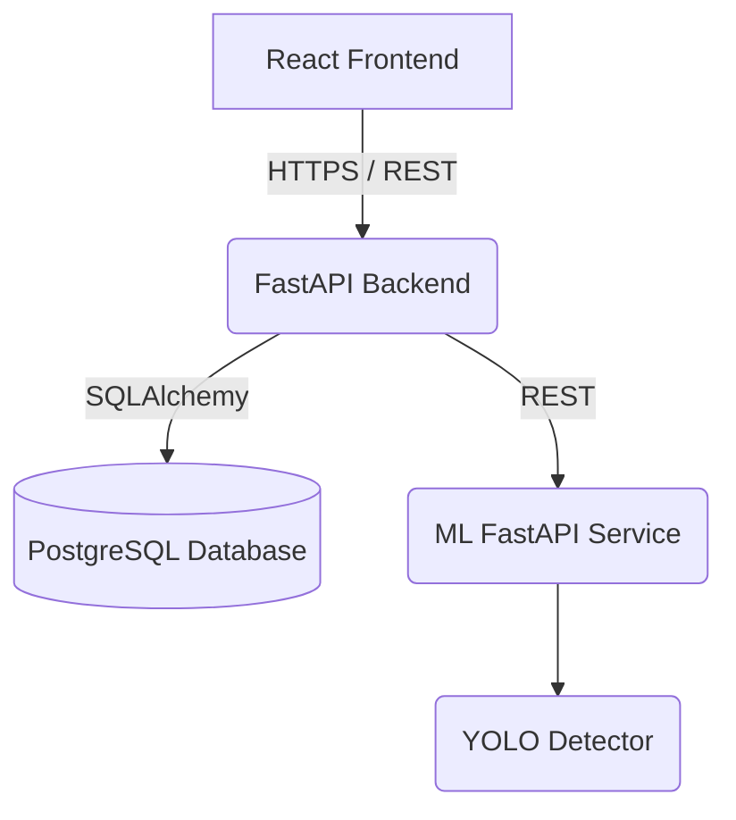

# Phase 0 Architecture Document
## 1. Project Overview
Real-Time Multi-Face Detection System for Automated Attendance. The system aims to build a robust real-time multi-face detection system designed for an academic classroom attendance environment. The ML model will focus strictly on face detection, leaving identity recognition and business logic to downstream or separate modules.

## 2. Objectives
- Build a real-time face detection ML service.
- Architect a clean separation between the React frontend, FastAPI backend, and FastAPI ML service.
- Prepare a scalable foundation for upcoming project phases (1 through 12).
- Establish project rules, development workflows, and project structure.

## 3. Scope
- Face detection returning bounding boxes, confidence scores, detected face count, and inference time.
- REST API integration between frontend and backend.
- REST API integration between backend and ML service.
- Role-Based Access Control (RBAC) supporting ADMIN and USER roles.
- Relational database schema for students, users, and attendance records.

## 4. Out of Scope
- Face recognition / identity matching (in Phase 0 and ML service scope).
- Attendance logic inside the ML service.
- Direct communication between frontend and ML service.
- Direct communication between ML service and PostgreSQL.

## 5. Functional Requirements
- **Face Detection**: Ability to process an image and return bounding boxes and confidences for human faces.
- **Attendance Management**: Ability to start/stop attendance sessions, view attendance, and generate reports.
- **User Management**: Admin can manage users and students. Users can view their own profile and attendance.

## 6. Non-functional Requirements
- **Performance**: Real-time or near-real-time inference speed.
- **Scalability**: Independently deployable ML and Backend services.
- **Security**: JWT authentication, RBAC, encrypted passwords, secure API endpoints.
- **Reliability**: Graceful error handling, standardized API responses, timeouts.

## 7. Technology Stack
- **Frontend**: React, TypeScript, Vite, Tailwind CSS (developed via Lovable AI).
- **Backend**: Python, FastAPI.
- **Database**: PostgreSQL, SQLAlchemy.
- **Machine Learning**: Python, PyTorch, YOLO, OpenCV.
- **Auth**: JWT, RBAC.
- **Testing**: pytest.
- **Deployment**: Docker.

## 8. System Architecture

## 9. ML Architecture
The ML Service is a self-contained FastAPI application wrapping the PyTorch/YOLO inference logic.
Flow: Image input -> Preprocessing -> YOLO Face Detection -> Confidence filtering -> NMS -> Detection results JSON output.

## 10. Backend Architecture
The FastAPI Backend handles all business logic, authorization, database interactions, and acts as a gateway to the ML service.

## 11. Database Architecture
PostgreSQL tables:
- `users`: id, username, password_hash, role
- `students`: id, student_id, name
- `attendance_sessions`: id, course_name, start_time, end_time, created_by
- `attendance`: id, session_id, student_id, timestamp, status

## 12. Security Architecture
- JWT-based authentication.
- Passwords hashed using bcrypt.
- Roles: ADMIN, USER. API endpoints protected via FastAPI dependencies.
- No direct internet access to the database or ML service.

## 13. API Architecture
- Backend APIs for Auth, Users, Students, Attendance Sessions, Attendance Records, System Status.
- ML APIs for Health, Model Info, and Prediction.

## 14. Data Flow
1. User uploads an image via Frontend.
2. Frontend sends multipart/form-data to Backend API.
3. Backend validates request and auth.
4. Backend proxies image payload to ML Service.
5. ML Service runs inference and returns JSON boxes.
6. Backend processes ML result and generates attendance records (business logic).
7. Backend returns success/failure to Frontend.

## 15. Project Structure
- `/ml-service`: FastAPI app for ML model.
- `/backend`: FastAPI app for main business logic.
- `/frontend`: React application (placeholder for now).
- `/dataset`: Image dataset (placeholder for Phase 1).
- `/models`: Stored YOLO weights and models.
- `/configs`: Application configurations.
- `/tests`: pytest test suites.
- `/docs`: Project documentation.
- `/reports`: Evaluation and profiling reports.

## 16. Testing Strategy
- **Unit Tests**: testing core Python logic, PyTorch inference wrapper, FastAPI routes.
- **Integration Tests**: Database access, Backend-to-ML communication.
- **Framework**: `pytest`.

## 17. Deployment Strategy
- **Docker**: Containerize Frontend, Backend, ML Service, and PostgreSQL.
- **Orchestration**: `docker-compose` for local/testing.

## 18. Phase 1 Prerequisites
- Ensure the ~10,000 image dataset is copied into `/dataset`.
- Read and adhere to dataset handling rules (do not modify destructively).
